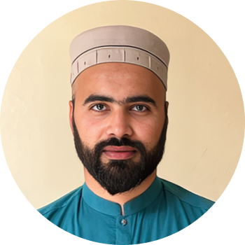
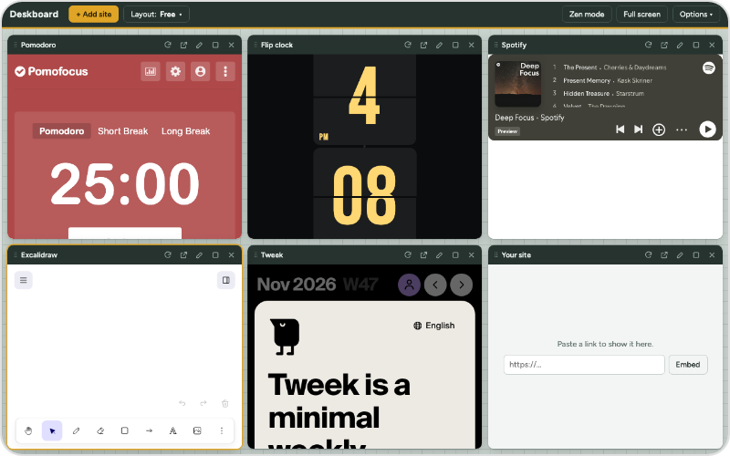
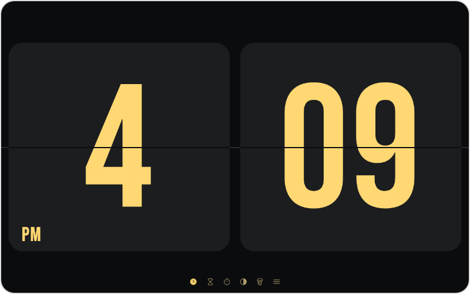
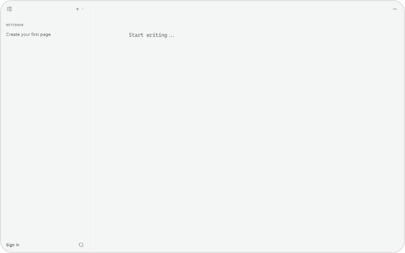
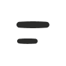

# Osama

**Designer, Developer & Marketer**

Building websites that look good, work fast, and convert.

[Website](https://madebyosama.com) · [Book a Call](https://cal.com/madebyosama/meeting)

---

### About

I'm Osama, a designer, developer and marketer focused on building thoughtful digital experiences for businesses and agencies.

Currently building **Loqaat**. Previously co-founded **SolversCave**.

### Tools

         

### Experience

| Company | Role | Period |
|:--|:--|:--|
| Loqaat | Founder | 2025 — Present |
| SolversCave | Cofounder | 2020 — 2023 |
| Morosoft | Website Designer | 2018 — 2019 |

### Side Projects

<table>
  <tr>
    <td valign="middle"></td>
    <td valign="middle"><b><a href="https://desk.madebyosama.com">Deskboard</a></b> A free-form board for arranging websites.</td>
  </tr>
  <tr>
    <td valign="middle"></td>
    <td valign="middle"><b><a href="https://flipclock.madebyosama.com">Flip Clock</a></b> Timer, stopwatch and alarm.</td>
  </tr>
  <tr>
    <td valign="middle"></td>
    <td valign="middle"><b><a href="https://notebook.madebyosama.com">Notebook</a></b> Minimal notes app.</td>
  </tr>
  <tr>
    <td valign="middle"></td>
    <td valign="middle"><b><a href="https://notes.madebyosama.com">Notes</a></b> Syncable notes across devices.</td>
  </tr>
  <tr>
    <td valign="middle"></td>
    <td valign="middle"><b><a href="https://workout.madebyosama.com">Workout</a></b> Workout tracker with rest timer.</td>
  </tr>
  <tr>
    <td valign="middle"></td>
    <td valign="middle"><b><a href="https://tools.madebyosama.com">Tools</a></b> Free, private tools that run in your browser.</td>
  </tr>
</table>

### Connect

[Email](mailto:hello@madebyosama.com) · [WhatsApp](https://wa.me/923352522522) · [Instagram](https://instagram.com/madebyosama) · [LinkedIn](https://linkedin.com/in/madebyosama) · [GitHub](https://github.com/madebyosama) · [Threads](https://threads.net/madebyosama) · [YouTube](https://youtube.com/@madebyosama) · [Figma](https://figma.com/@madebyosama)

---

  © 2026 Osama · <a href="https://madebyosama.com">madebyosama.com</a>

